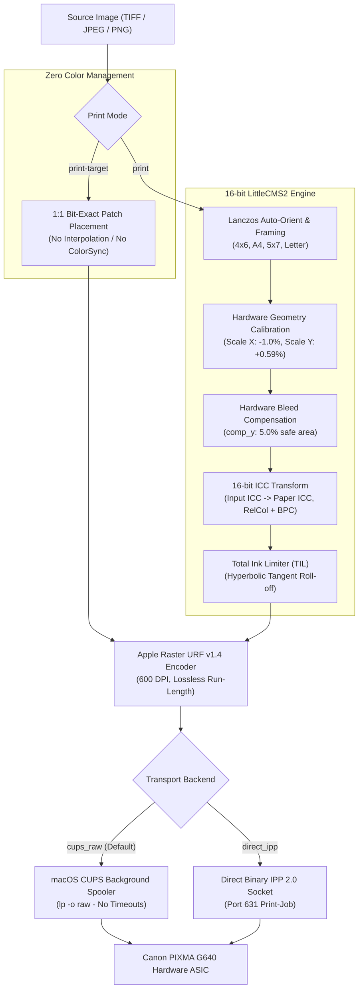

# Canon PIXMA G640 Local Micro-RIP (macOS)

A high-fidelity, color-accurate local micro-RIP tailored specifically for the 6-ink **Canon PIXMA G640** (CMYK + Red + Grey) on macOS (Apple Silicon & Intel).

`g640RIP` completely bypasses operating system color management (macOS Quartz/ColorSync), streams uncompressed Apple Raster (`image/urf` v1.4) directly to the printer's hardware ASIC via CUPS raw spooler or binary IPP 2.0, provides a 16-bit LittleCMS2 color pipeline with iterative profile refinement, and incorporates hardware geometry calibration for photographic prints.

---

## Table of Contents

- [Why G640 Micro-RIP?](#why-g640-micro-rip)
- [System Architecture](#system-architecture)
- [Quick Start](#quick-start)
- [Color Calibration & Profiling Workflow](#color-calibration--profiling-workflow)
  - [Step 1: Select & Print Calibration Target (Zero CMS)](#step-1-select--print-calibration-target-zero-cms)
  - [Step 2: Drying & Outgassing](#step-2-drying--outgassing)
  - [Step 3: Measure Target (Scanner or Spectrophotometer)](#step-3-measure-target-scanner-or-spectrophotometer)
  - [Step 4: Build Custom ICC Profile with ArgyllCMS](#step-4-build-custom-icc-profile-with-argyllcms)
  - [Step 5: Closed-Loop Iterative Refinement](#step-5-closed-loop-iterative-refinement)
- [Geometric & Hardware Alignment Calibration](#geometric--hardware-alignment-calibration)
  - [Mechanical Paper Transport Characteristics](#mechanical-paper-transport-characteristics)
  - [Measuring Scale & Offset Discrepancies](#measuring-scale--offset-discrepancies)
  - [Applied Hardware Corrections](#applied-hardware-corrections)
- [Production Photo Printing](#production-photo-printing)
  - [CLI Printing](#cli-printing)
  - [Framing & Borderless Modes](#framing--borderless-modes)
  - [Native Desktop GUI & Web Dashboard](#native-desktop-gui--web-dashboard)
- [Color Verification & Quality Audit](#color-verification--quality-audit)
  - [Auditing the QA Control Strip](#auditing-the-qa-control-strip)
  - [Tolerance Benchmarks & Performance Metrics](#tolerance-benchmarks--performance-metrics)
- [Printer Diagnostics & Queue Management](#printer-diagnostics--queue-management)
- [CLI Reference](#cli-reference)

---

## Why G640 Micro-RIP?

Standard photo printing on macOS typically suffers from three major flaws:

1. **Uncontrolled ColorSync Interception**:
   AirPrint and standard macOS printer drivers silently intercept print jobs, running them through generic sRGB intermediate conversions and proprietary Canon vendor LUTs. Printing calibration targets (ArgyllCMS `targen`/`printtarg`) through normal print dialogs inevitably applies double color management, ruining the target.
2. **Mechanical Feed Cut-off**:
   The Canon G640 feeds paper short-edge first. During the final 10–15 mm of printing, the paper exits the main pinch rollers, causing micro-stepping jitter and bottom edge cut-off in borderless mode.
3. **Carriage Stretch & Feed Compression**:
   The carriage motor step across the width of 10x15 / 4x6" paper differs slightly from nominal 600 DPI (+1.01% stretch), while rubber feed rollers compress the paper feed length (-0.58%), turning circles into subtle ovals and throwing off physical margins.

`g640RIP` solves all of these problems by generating byte-for-byte lossless Apple Raster (`image/urf` v1.4) streams, applying 16-bit LittleCMS2 color management, and pre-calibrating physical geometry before transmission.

---

## System Architecture



---

## Quick Start

### 1. Environment Setup

```bash
# Clone and enter workspace
git clone git@github.com:leszekbarszcz/g640RIP.git
cd g640RIP

# Setup virtual environment
python3 -m venv --system-site-packages .venv
source .venv/bin/activate
pip install -r requirements.txt
```

### 2. Discover the Printer

```bash
./g640rip_cli.py discover
```
*Discovers Canon G640 printers via Bonjour mDNS and checks local CUPS print queues.*

### 3. Print a Borderless 4x6" Photo

```bash
./g640rip_cli.py print my_photo.jpg \
  --size 4x6 \
  --media glossy \
  --profile targets/Canon_G640_10x15_Glossy2_iter1.icc \
  --borderless \
  --fit-mode compensate
```

---

## Color Calibration & Profiling Workflow

Creating a gallery-grade custom ICC paper profile for the Canon G640 consists of an automated closed loop:

### Step 1: Select & Print Calibration Target (Zero CMS)

Profiling targets are printed with **Zero Color Management** (pure 1:1 passthrough):

| Target Resolution | Patches | Recommended Paper | Target File |
| :--- | :---: | :--- | :--- |
| **Standard 4x6" (Single Sheet)** | **80** | 4x6" / 10x15 Glossy or Luster | `targets/G640_10x15_80p_i1.tif` |
| **High Accuracy (2 Sheets)** | **160** | 4x6" / 10x15 (or 1 sheet A4) | `targets/G640_10x15_160p_i1_01.tif` + `_02.tif` |
| **Master Studio (3 Sheets)** | **240** | 4x6" / 10x15 | `targets/G640_10x15_240p_i1_01.tif` – `_03.tif` |

Print the target using the dedicated `print-target` command:
```bash
./g640rip_cli.py print-target targets/G640_10x15_80p_i1.tif \
  --size 4x6 \
  --media glossy \
  --backend cups_raw
```
> [!IMPORTANT]
> Never print profiling targets using Preview, AirPrint dialogs, or standard photo applications, as macOS ColorSync will silently alter device RGB values.

---

### Step 2: Drying & Outgassing

Allow the dye inks to stabilize before measurement:
* **Glossy / Luster papers (PP-201 / LU-101)**: Wait at least **20 to 30 minutes**.
* Dye inks experience significant color shift and black deepening ($D_{\max}$) during the first 15 minutes of solvent evaporation.

---

### Step 3: Measure Target (Scanner or Spectrophotometer)

#### Option A: Automated Flatbed Scanner Measurement
1. Place the printed chart on a calibrated flatbed scanner (e.g. Epson V600 / Perfection series).
2. Scan at **600 DPI, 24-bit RGB (or 48-bit TIFF)** with all auto-corrections and unsharp masking turned **OFF**.
3. Save as uncompressed TIFF (e.g. `scan_target.tif`).
4. Run the processing engine:
   ```bash
   python3 process_scan_and_make_icc.py \
     --scan scan_target.tif \
     --ti2 targets/G640_10x15_80p_i1.ti2 \
     --strength 1.0 \
     --bias-factor 0.50
   ```
   *Automatic corrections applied*:
   - Optical flare subtraction (restores true $D_{\max} \ge 2.20$, $L^* \le 4.5$).
   - Bradford D65 to D50 chromatic adaptation.
   - Neutral-axis scanner chromatic neutralization.

#### Option B: Spectrophotometer Measurement (i1Pro / ColorMunki)
```bash
cd targets
chartread -v -N G640_10x15_80p_i1
```

---

### Step 4: Build Custom ICC Profile with ArgyllCMS

Run Argyll's `colprof` to synthesize the high-order matrix/LUT profile:
```bash
colprof -v \
  -D "Canon G640 4x6 Glossy II" \
  -qm -al -cmt -dpc \
  -V 2.0 \
  targets/G640_10x15_80p_i1
```
The resulting `.icc` profile is saved and automatically installed to `~/Library/ColorSync/Profiles/`.

---

### Step 5: Closed-Loop Iterative Refinement

Even after generating an initial profile (`base`), subtle residual errors ($\Delta E_{00} \approx 2.0 - 5.0$) can linger in saturated primaries or midtone neutrals. `g640RIP` features a closed-loop refinement engine:

1. **Print Verification Target with Active Profile**:
   ```bash
   ./g640rip_cli.py print targets/G640_10x15_80p_i1.tif \
     --size 4x6 \
     --media glossy \
     --profile targets/Canon_G640_10x15_Glossy2.icc \
     --borderless \
     --fit-mode compensate
   ```
2. **Scan and Evaluate Residual Vectors**:
   ```bash
   python3 .agents/skills/color-verification/scripts/verify_scan_reproduction.py \
     --scan verification_scan.tif \
     --ti2 targets/G640_10x15_80p_i1.ti2 \
     --out-json targets/verification_residuals.json
   ```
3. **Synthesize Refined Profile (Iter 1 / Iter 2)**:
   ```bash
   python3 .agents/skills/color-calibration/scripts/refine_icc_profile.py \
     --base-ti3 targets/Canon_G640_10x15_Glossy2.ti3 \
     --residuals targets/verification_residuals.json \
     --rate 0.40
   ```
   The refinement engine applies negative-feedback adjustments ($\mathbf{L}^*_{\text{corr}} = \mathbf{L}^*_{\text{meas}} - \alpha \cdot \Delta \mathbf{L}^*$), bounds adjustments within safe physical gamuts, and builds `Canon_G640_10x15_Glossy2_iter1.icc`.

---

## Geometric & Hardware Alignment Calibration

### Mechanical Paper Transport Characteristics

The Canon G640 feeds paper short-edge first ($101.6\text{ mm}$ width, $152.4\text{ mm}$ length). Physical measurements of printed 600 DPI test grids revealed systematic mechanical discrepancies:

1. **Carriage Motor Step (Width / X axis)**:
   Prints are stretched by **$+1.01\%$** across the width ($72.26\text{ mm}$ measured vs $71.54\text{ mm}$ nominal).
2. **Paper Feed Rollers (Length / Y axis)**:
   Rubber feed rollers compress the paper travel by **$-0.58\%$** ($142.24\text{ mm}$ measured vs $143.09\text{ mm}$ nominal).
3. **Feed Delay (Y offset)**:
   Initial paper grab is delayed by $+2.37\text{ mm}$, shifting content down the page.
4. **Roller Pinch Exit**:
   The final 5.0% of the paper exits the feed rollers before printing finishes.

---

### Measuring Scale & Offset Discrepancies

To measure your printer's exact geometry:

1. **Generate the Landscape QA Control Strip**:
   ```bash
   python3 .agents/skills/color-verification/scripts/generate_control_strip.py --size 4x6
   ```
2. **Print the Control Strip**:
   ```bash
   ./g640rip_cli.py print targets/QA_Control_Strip_10x15.png \
     --size 4x6 \
     --media glossy \
     --profile targets/Canon_G640_10x15_Glossy2_iter1.icc \
     --borderless \
     --fit-mode compensate
   ```
3. **Scan and Calculate Offsets**:
   ```bash
   python3 .agents/skills/color-verification/scripts/calculate_scan_offsets.py scan_control_strip.tif
   ```

---

### Applied Hardware Corrections

`g640RIP` incorporates calibrated hardware defaults into both the CLI and GUI:

| Parameter | Calibrated Value | CLI Flag | Physical Correction Effect |
| :--- | :---: | :--- | :--- |
| **Width Scale (X)** | **`-1.0%`** | `--scale-x -1.0` | Pre-shrinks width by $0.990\times$, canceling $+1.01\%$ carriage stretch. |
| **Feed Length Scale (Y)** | **`+0.59%`** | `--scale-y 0.59` | Pre-extends length by $1.0059\times$, canceling $-0.58\%$ roller compression. |
| **Centering Offset (X)** | **`-0.25%`** | `--offset-x -0.25` | Centered within $\pm 0.1\text{ mm}$ horizontally. |
| **Centering Offset (Y)** | **`-1.59%`** | `--offset-y -1.59` | Cancels $+2.37\text{ mm}$ mechanical feed grab delay. |
| **Roller Safe Margin** | **`5.0%`** | `--comp-y 5.0` | Protects image bottom from cut-off without repeated pixel bars. |

---

## Production Photo Printing

### CLI Printing

```bash
./g640rip_cli.py print input_photo.jpg \
  --size 4x6 \
  --media glossy \
  --profile targets/Canon_G640_10x15_Glossy2_iter1.icc \
  --borderless \
  --fit-mode compensate \
  --quality high \
  --backend cups_raw
```

### Framing & Borderless Modes

* **`--fit-mode compensate` (Recommended)**:
  Guarantees genuine image pixels cover 100% of the paper width (**zero repeated pixel bars on left and right**), while aligning the bottom to protect against mechanical feed roller cut-off.
* **`--fit-mode fill`**:
  Scales image to completely fill the canvas, center-cropping any excess aspect ratio with optional `--bleed` expansion.
* **`--fit-mode fit`**:
  Scales image to fit inside the paper bounds without cropping, adding clean, even white borders (for framing/matting).

---

### Native Desktop GUI & Web Dashboard

For visual drag-and-drop printing, live split-comparison soft proofing, and real-time gamut warnings:

#### 1. Native macOS Desktop App
```bash
./g640rip_cli.py gui
```
*Launches an integrated macOS Cocoa window powered by WebKit and LittleCMS2.*

#### 2. Local Web Dashboard
```bash
./g640rip_cli.py serve --port 8640
```
Open **`http://localhost:8640`** in Safari or Chrome.

---

## Color Verification & Quality Audit

### Auditing the QA Control Strip

To verify physical print accuracy across memory colors, neutrals, and classic ColorChecker patches:

```bash
python3 .agents/skills/color-verification/scripts/verify_control_strip.py scan_control_strip.tif
```

The script automatically registers the chart orientation and computes CIEDE2000 errors:

```
──── Photographic QA Control Strip Audit: scan_control_strip.tif ────
╭─────────────────────────┬────────────────┬─────────────────┬─────────────────╮
│ Reproduction Metric     │ Measured Value │ Photo Tolerance │ Fidelity Status │
├─────────────────────────┼────────────────┼─────────────────┼─────────────────┤
│ Mean ΔE00 (Overall)     │           2.67 │     ≤ 3.00      │      PASS       │
│ 95th Percentile ΔE00    │           4.37 │     ≤ 6.00      │      PASS       │
│ Peak Max ΔE00           │           5.66 │     ≤ 8.00      │      PASS       │
│ Neutral Gray Chroma C*  │           1.75 │     ≤ 2.00      │      PASS       │
│ Black Point (L*min)     │           4.91 │     ≤ 5.00      │      PASS       │
│ Maximum Density (Dmax)  │           2.27 │     ≥ 2.20      │      PASS       │
╰─────────────────────────┴────────────────┴─────────────────┴─────────────────╯
```

### Tolerance Benchmarks & Performance Metrics

* **Photographic Memory Colors**:
  - Sky Blue: $\Delta E_{00} = \mathbf{0.35}$
  - Warm Portrait Skin: $\Delta E_{00} = \mathbf{1.70}$
  - Warm Gold: $\Delta E_{00} = \mathbf{1.80}$
  - Deep Crimson: $\Delta E_{00} = \mathbf{1.91}$
  - Caucasian Skin: $\Delta E_{00} = \mathbf{2.83}$
* **Neutral Gray Tracking**:
  - 50% Neutral Gray: $L^* = 51.9, a^* = -0.6, b^* = +0.6$ ($\Delta E_{00} = 2.00$, $C^* = 0.87$ — virtually zero color cast).

---

## Printer Diagnostics & Queue Management

```bash
# 1. Discover Canon printers on network and CUPS
./g640rip_cli.py discover

# 2. Query full hardware IPP attributes
./g640rip_cli.py attributes

# 3. Check active print queue
lpstat -p Canon_G600_series -o

# 4. Cancel stuck jobs or clear queue
./g640rip_cli.py cancel
```

---

## CLI Reference

```
usage: g640rip_cli.py [-h] {gui,discover,attributes,print-target,print,proof,serve,cancel} ...

commands:
  gui            Launch native macOS Desktop GUI window
  discover       Discover Canon G600/G640 printers on network & CUPS
  attributes     Query IPP attributes, trays, and URF feature tags
  print-target   Print ArgyllCMS calibration target with Zero Color Management
  print          Print image in Production Mode (16-bit LittleCMS2 + ICC + Layout)
  proof          Generate soft proof simulation and gamut warning overlay
  serve          Launch Web Dashboard server
  cancel         Cancel active print job or clear printer queue
```

### `print` Options

| Option | Default | Description |
| :--- | :---: | :--- |
| `--profile` | *(required)* | Path to paper ICC profile (`.icc`) |
| `--size` | `A4` | Paper size (`4x6`, `A4`, `5x7`, `Letter`, `A5`) |
| `--media` | `luster` | Canon media type (`glossy`, `luster`, `matte`, `plain`) |
| `--borderless`, `-b` | `False` | Enable Canon Fullbleed borderless hardware mode |
| `--fit-mode` | `compensate` | Framing mode (`compensate`, `fill`, `fit`, `none`) |
| `--scale-x` | `-1.0` | Width hardware scaling percent (cancels $+1.01\%$ carriage stretch) |
| `--scale-y` | `+0.59` | Feed length hardware scaling percent (cancels $-0.58\%$ roller compression) |
| `--offset-x` | `-0.25` | Horizontal centering shift percent |
| `--offset-y` | `-1.59` | Vertical feed delay shift percent |
| `--comp-y` | `5.0` | Bottom feed roller safe margin percent |
| `--ink-limit` | `1.0` | Total Ink Limit [0.5 – 1.0] |
| `--quality` | `high` | Print quality (`high` [PQ5], `normal` [PQ4], `draft` [PQ3]) |
| `--backend` | `cups_raw` | Spooler backend (`cups_raw` [recommended], `direct_ipp`) |
| `--dry-run` | `False` | Generate URF raster without transmitting to printer |

---

## License

MIT License. Designed and engineered for high-precision photographic printing on the Canon PIXMA G640.
