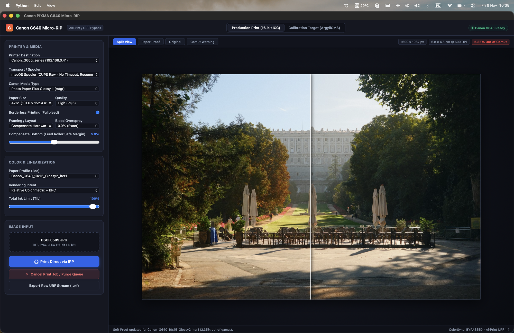
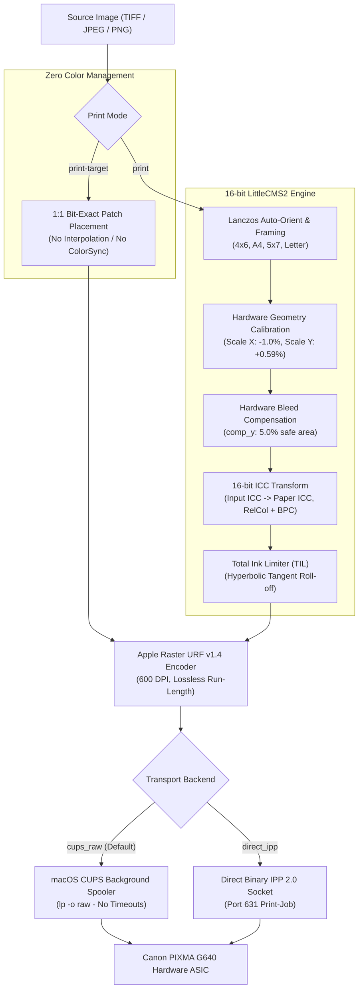
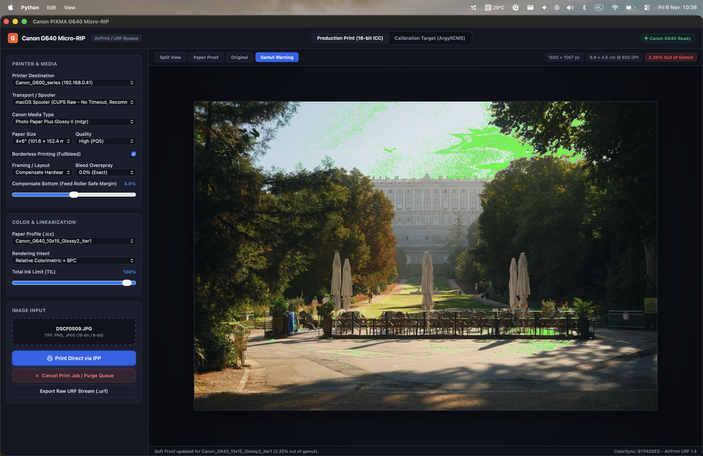
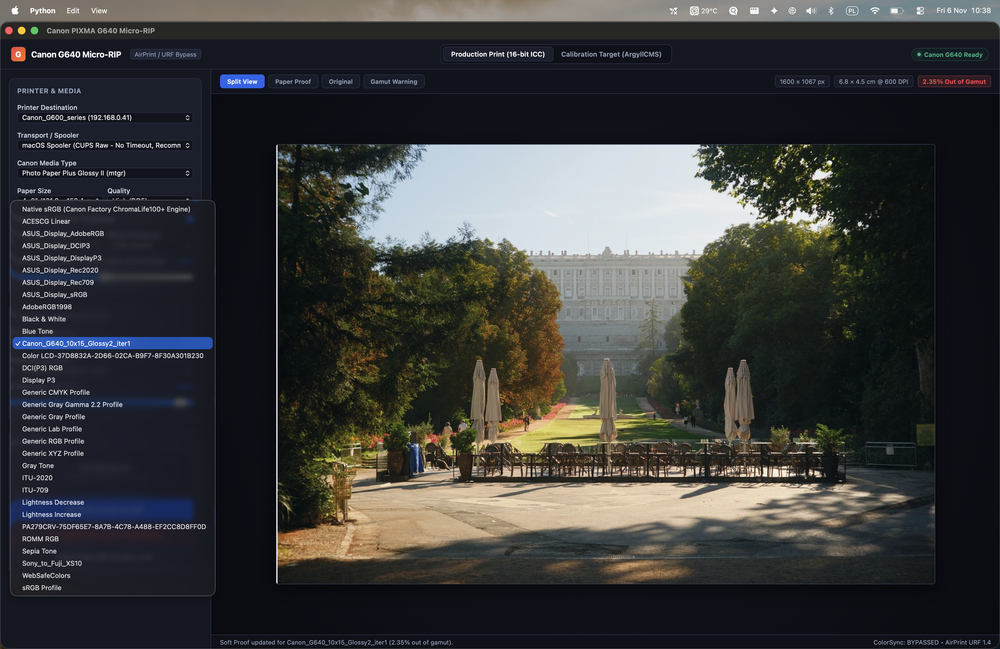

# Canon PIXMA G640 Local Micro-RIP (macOS)

A high-fidelity, color-accurate local micro-RIP tailored specifically for the 6-ink **Canon PIXMA G640** (CMYK + Red + Grey) on macOS (Apple Silicon & Intel).

`g640RIP` completely bypasses operating system color management (macOS Quartz/ColorSync), streams uncompressed Apple Raster (`image/urf` v1.4) directly to the printer's hardware ASIC via CUPS raw spooler or binary IPP 2.0, provides a 16-bit LittleCMS2 color pipeline with iterative profile refinement, and incorporates hardware geometry calibration for photographic prints.

<p align="center">
  
</p>
<p align="center">
  <em>Native macOS Desktop GUI featuring real-time 16-bit LittleCMS2 split-view soft proofing (Original vs. Paper Proof) and hardware geometry calibration.</em>
</p>

---

## Table of Contents

- [Why G640 Micro-RIP?](#why-g640-micro-rip)
- [System Architecture](#system-architecture)
- [Quick Start](#quick-start)
- [Color Calibration & Profiling Workflow](#color-calibration--profiling-workflow)
  - [Prerequisites: ArgyllCMS](#prerequisites-argyllcms)
  - [Step 1: Generate Calibration Targets (ArgyllCMS)](#step-1-generate-calibration-targets-argyllcms)
  - [Step 2: Select & Print Calibration Target (Zero CMS)](#step-2-select--print-calibration-target-zero-cms)
  - [Step 3: Drying & Outgassing](#step-3-drying--outgassing)
  - [Step 4: Measure Target & Generate Custom ICC Profile](#step-4-measure-target--generate-custom-icc-profile)
  - [Step 5: Closed-Loop Iterative Refinement](#step-5-closed-loop-iterative-refinement)
- [Geometric & Hardware Alignment Calibration](#geometric--hardware-alignment-calibration)
  - [Mechanical Paper Transport Characteristics](#mechanical-paper-transport-characteristics)
  - [Measuring Scale & Offset Discrepancies](#measuring-scale--offset-discrepancies)
  - [Applied Hardware Corrections](#applied-hardware-corrections)
- [Production Photo Printing](#production-photo-printing)
  - [CLI Printing](#cli-printing)
  - [Framing & Borderless Modes](#framing--borderless-modes)
  - [Native Desktop GUI & Web Dashboard](#native-desktop-gui--web-dashboard)
  - [Graphical Interface Walkthrough](#graphical-interface-walkthrough)
- [Color Verification & Quality Audit](#color-verification--quality-audit)
  - [Auditing the QA Control Strip](#auditing-the-qa-control-strip)
  - [Tolerance Benchmarks & Performance Metrics](#tolerance-benchmarks--performance-metrics)
- [Printer Diagnostics & Queue Management](#printer-diagnostics--queue-management)
- [CLI Reference](#cli-reference)

---

## Why G640 Micro-RIP?

Standard photo printing on macOS typically suffers from three major flaws:

1. **Uncontrolled ColorSync Interception**:
   AirPrint and standard macOS printer drivers silently intercept print jobs, running them through generic sRGB intermediate conversions and proprietary Canon vendor LUTs. Printing calibration targets (ArgyllCMS `targen`/`printtarg`) through normal print dialogs inevitably applies double color management, ruining the target.
2. **Mechanical Feed Cut-off**:
   The Canon G640 feeds paper short-edge first. During the final 10–15 mm of printing, the paper exits the main pinch rollers, causing micro-stepping jitter and bottom edge cut-off in borderless mode.
3. **Carriage Stretch & Feed Compression**:
   The carriage motor step across the width of 10x15 / 4x6" paper differs slightly from nominal 600 DPI (+1.01% stretch), while rubber feed rollers compress the paper feed length (-0.58%), turning circles into subtle ovals and throwing off physical margins.

`g640RIP` solves all of these problems by generating byte-for-byte lossless Apple Raster (`image/urf` v1.4) streams, applying 16-bit LittleCMS2 color management, and pre-calibrating physical geometry before transmission.

---

## System Architecture



---

## Quick Start

### Installation & Execution Options

#### Option A: Run from Source (Python) (Recommended)

Running directly from source gives you immediate access to all calibration scripts, verification tools, and the latest RIP features:

```bash
# Clone and enter workspace
git clone git@github.com:lespatrick/g640rip.git
cd g640rip

# Setup virtual environment
python3 -m venv --system-site-packages .venv
source .venv/bin/activate
pip install -r requirements.txt

# Verify CLI execution
./g640rip_cli.py --help
```

#### Option B: Pre-compiled Standalone Binary

No Python setup or virtual environment required. Download the pre-built Apple Silicon (`arm64`) executable from [GitHub Releases](https://github.com/lespatrick/g640rip/releases):

```bash
# Extract the downloaded archive
tar -xzvf g640rip-macos-arm64-v*.tar.gz
chmod +x g640rip

# Verify execution
./g640rip --help
```

> [!NOTE]
> **ICC Profiles are External**: Custom ICC paper profiles are **never embedded** inside the binary. The binary dynamically loads profiles from your local `targets/` directory (e.g. `targets/<profile>.icc`) or macOS system profile folders (`~/Library/ColorSync/Profiles`). Users have full freedom to add, swap, and calibrate their own paper profiles without modifying the executable.

*(Note: In all examples below, `./g640rip_cli.py` [source] and `./g640rip` [standalone binary] can be used interchangeably).*

---

### 1. Discover the Printer

```bash
./g640rip_cli.py discover
```
*Discovers Canon G640 printers via Bonjour mDNS and checks local CUPS print queues.*

### 2. Print a Borderless 4x6" Photo

```bash
./g640rip_cli.py print my_photo.jpg \
  --size 4x6 \
  --media glossy \
  --profile targets/<profile>.icc \
  --borderless \
  --fit-mode compensate
```

---

## Color Calibration & Profiling Workflow

Creating a gallery-grade custom ICC paper profile for the Canon G640 consists of an automated closed loop:

### Prerequisites: ArgyllCMS

Profiling target generation, spectrophotometer instrument reading, and ICC synthesis require the open-source **ArgyllCMS** color management system. Install via Homebrew on macOS:

```bash
brew install argyll-cms
```

Verify that the Argyll toolchain (`targen`, `printtarg`, `colprof`, `chartread`) is available:
```bash
which targen printtarg colprof chartread
```

---

### Step 1: Generate Calibration Targets (ArgyllCMS)

ArgyllCMS profiling relies on three tightly coupled file formats:
- **`.ti1`**: Target description specifying the device color space and patch distribution (RGB steps and neutral grey ramps).
- **`.ti2`**: Spatial layout file mapping every patch code to its 2D physical sheet coordinates (required for scanner alignment and spectrophotometer strip reading).
- **`.tif`**: Lossless 600 DPI RGB raster ready for 1:1 hardware transmission.

#### Option A: Automated Target Generator (Recommended)

Generate all standard profiling charts (80p, 160p, 240p) and the visual QA evaluation strip directly into `targets/`:

```bash
# Generate all standard targets for 4x6" / 10x15 cm paper
./scripts/generate_targets.sh all 10x15

# Or generate only the standard single-sheet 80-patch target
./scripts/generate_targets.sh 80 10x15
```

| Target Resolution | Patches | Sheets | Recommended Paper | Target File |
| :--- | :---: | :---: | :--- | :--- |
| **Standard 4x6" (Single Sheet)** | **80** | **1** | 4x6" / 10x15 Glossy or Luster | `targets/G640_10x15_80p_i1.tif` |
| **High Accuracy (2 Sheets)** | **160** | **2** | 4x6" / 10x15 (or 1 sheet A4) | `targets/G640_10x15_160p_i1_01.tif` + `_02.tif` |
| **Master Studio (3 Sheets)** | **240** | **3** | 4x6" / 10x15 | `targets/G640_10x15_240p_i1_01.tif` – `_03.tif` |

#### Option B: Manual ArgyllCMS Commands

If you wish to customize patch counts, step increments, or paper dimensions manually:

```bash
# 1. Generate target color distribution (.ti1) with single-channel and neutral grey ramps
# -d2 (RGB printer), -s8 (8 single-channel steps), -g8 (8 composite grey steps), -f80 (80 total patches)
targen -v -d2 -s8 -g8 -f80 targets/G640_10x15_80p_i1

# 2. Layout printable patches into 600 DPI bitmap (.tif) and reading definition (.ti2)
# -i i1 (X-Rite i1Pro layout), -t 600 (600 DPI), -p 101.6x152.4 (exact 4x6" in mm)
printtarg -v -i i1 -t 600 -p 101.6x152.4 targets/G640_10x15_80p_i1
```

> [!NOTE]
> The exact millimeter dimensions for 4x6" paper are **`101.6x152.4`** mm ($4 \times 25.4\text{ mm} \times 6 \times 25.4\text{ mm}$). Using nominal `100x149` causes Argyll to split an 80-patch target across two sheets; using `101.6x152.4` fits all 80 patches comfortably onto a single 4x6" sheet with standard i1 boundary margins.

---

### Step 2: Select & Print Calibration Target (Zero CMS)

Profiling targets must be printed with **Zero Color Management** (pure 1:1 device RGB passthrough):

Print the target using the dedicated `print-target` command:
```bash
./g640rip_cli.py print-target targets/G640_10x15_80p_i1.tif \
  --size 4x6 \
  --media glossy \
  --backend cups_raw
```
> [!IMPORTANT]
> Never print profiling targets using Preview, AirPrint dialogs, or standard photo applications, as macOS ColorSync will silently alter device RGB values.

---

### Step 3: Drying & Outgassing

Allow the dye inks to stabilize before measurement:
* **Glossy / Luster papers (PP-201 / LU-101)**: Wait at least **20 to 30 minutes**.
* Dye inks experience significant color shift and black deepening ($D_{\max}$) during the first 15 minutes of solvent evaporation.

---

### Step 4: Measure Target & Generate Custom ICC Profile

#### Option A: Integrated Flatbed Scanner Pipeline (One-Step)

The Canon PIXMA G640 includes an integrated flatbed scanner on top, making custom ICC paper profiling completely self-contained without requiring an external spectrophotometer. The scanner pipeline is fully automated: it reads the scanned patches, compensates for optical scanner characteristics, runs ArgyllCMS `colprof`, and installs the resulting ICC profile to your system in a single command:

1. Place the printed chart on the printer's integrated flatbed scanner glass (aligned to the top-left corner).
2. Scan at **600 DPI, 24-bit RGB (or 48-bit TIFF)** with all auto-corrections and unsharp masking turned **OFF** (using macOS Image Capture or Canon IJ Scan Utility).
3. Save as uncompressed TIFF (e.g. `scan_target.tif`).
4. Run the automated processing engine:
   ```bash
   python3 process_scan_and_make_icc.py \
     --scan scan_target.tif \
     --ti2 targets/G640_10x15_80p_i1.ti2 \
     --strength 1.0 \
     --bias-factor 0.50
   ```
   *Corrections and synthesis automatically performed*:
   - **Optical flare subtraction**: Restores true physical black depth ($D_{\max} \ge 2.20$, $L^* \le 4.5$).
   - **Bradford D65 to D50 chromatic adaptation**: Converts scanner illuminant accurately to ICC PCS space.
   - **Neutral-axis scanner chromatic neutralization**: Evaluates neutral gray patches and eliminates sensor color cast.
   - **ICC Profile Synthesis**: Automatically runs ArgyllCMS `colprof` (`-qm -al -cmt -dpc -V 2.0`) to build the high-order profile.
   - **System Installation**: Automatically copies the generated profile into macOS `~/Library/ColorSync/Profiles`.

> [!TIP]
> **No External Hardware or Manual colprof Needed**: The G640's integrated scanner combined with `process_scan_and_make_icc.py` automatically builds and installs the `.icc` profile. You can proceed directly to [Step 5](#step-5-closed-loop-iterative-refinement) or production printing!

#### Option B: Spectrophotometer Pipeline (i1Pro / ColorMunki)

For hardware spectrophotometers using ArgyllCMS strip reading:

1. **Read chart patches**:
   ```bash
   cd targets
   chartread -v -N G640_10x15_80p_i1
   ```
2. **Synthesize ICC profile with Argyll `colprof`**:
   ```bash
   colprof -v \
     -D "Canon G640 4x6 Custom" \
     -qm -al -cmt -dpc \
     -V 2.0 \
     G640_10x15_80p_i1
   ```
   The resulting `.icc` profile is created directly in `targets/` (e.g. `targets/G640_10x15_80p_i1.icc`).

---

### Step 5: Closed-Loop Iterative Refinement

Even after generating an initial profile (`base`), subtle residual errors ($\Delta E_{00} \approx 2.0 - 5.0$) can linger in saturated primaries or midtone neutrals. `g640RIP` features a closed-loop refinement engine:

1. **Print Verification Target with Active Profile**:
   ```bash
   ./g640rip_cli.py print targets/G640_10x15_80p_i1.tif \
     --size 4x6 \
     --media glossy \
     --profile targets/<profile>.icc \
     --borderless \
     --fit-mode compensate
   ```
2. **Scan and Evaluate Residual Vectors**:
   ```bash
   python3 .agents/skills/color-verification/scripts/verify_scan_reproduction.py \
     --scan verification_scan.tif \
     --ti2 targets/G640_10x15_80p_i1.ti2 \
     --out-json targets/verification_residuals.json
   ```
3. **Synthesize Refined Profile (Iter 1 / Iter 2)**:
   ```bash
   python3 .agents/skills/color-calibration/scripts/refine_icc_profile.py \
     --base-ti3 targets/<profile>.ti3 \
     --residuals targets/verification_residuals.json \
     --rate 0.40
   ```
   The refinement engine applies negative-feedback adjustments ($\mathbf{L}^*_{\text{corr}} = \mathbf{L}^*_{\text{meas}} - \alpha \cdot \Delta \mathbf{L}^*$), bounds adjustments within safe physical gamuts, and builds `targets/<profile>_iter1.icc`.

---

## Geometric & Hardware Alignment Calibration

### Mechanical Paper Transport Characteristics

The Canon G640 feeds paper short-edge first ($101.6\text{ mm}$ width, $152.4\text{ mm}$ length). Physical measurements of printed 600 DPI test grids revealed systematic mechanical discrepancies:

1. **Carriage Motor Step (Width / X axis)**:
   Prints are stretched by **$+1.01\%$** across the width ($72.26\text{ mm}$ measured vs $71.54\text{ mm}$ nominal).
2. **Paper Feed Rollers (Length / Y axis)**:
   Rubber feed rollers compress the paper travel by **$-0.58\%$** ($142.24\text{ mm}$ measured vs $143.09\text{ mm}$ nominal).
3. **Feed Delay (Y offset)**:
   Initial paper grab is delayed by $+2.37\text{ mm}$, shifting content down the page.
4. **Roller Pinch Exit**:
   The final 5.0% of the paper exits the feed rollers before printing finishes.

---

### Measuring Scale & Offset Discrepancies

To measure your printer's exact geometry:

1. **Generate the Landscape QA Control Strip**:
   ```bash
   python3 .agents/skills/color-verification/scripts/generate_control_strip.py --size 4x6
   ```
2. **Print the Control Strip**:
   ```bash
   ./g640rip_cli.py print targets/QA_Control_Strip_4x6.png \
     --size 4x6 \
     --media glossy \
     --profile targets/<profile>.icc \
     --borderless \
     --fit-mode compensate
   ```
3. **Scan and Calculate Offsets**:
   ```bash
   python3 .agents/skills/color-verification/scripts/calculate_scan_offsets.py scan_control_strip.tif
   ```

---

### Applied Hardware Corrections

`g640RIP` incorporates calibrated hardware defaults into both the CLI and GUI:

| Parameter | Calibrated Value | CLI Flag | Physical Correction Effect |
| :--- | :---: | :--- | :--- |
| **Width Scale (X)** | **`-1.0%`** | `--scale-x -1.0` | Pre-shrinks width by $0.990\times$, canceling $+1.01\%$ carriage stretch. |
| **Feed Length Scale (Y)** | **`+0.59%`** | `--scale-y 0.59` | Pre-extends length by $1.0059\times$, canceling $-0.58\%$ roller compression. |
| **Centering Offset (X)** | **`-0.25%`** | `--offset-x -0.25` | Centered within $\pm 0.1\text{ mm}$ horizontally. |
| **Centering Offset (Y)** | **`-1.59%`** | `--offset-y -1.59` | Cancels $+2.37\text{ mm}$ mechanical feed grab delay. |
| **Roller Safe Margin** | **`5.0%`** | `--comp-y 5.0` | Protects image bottom from cut-off without repeated pixel bars. |

---

## Production Photo Printing

### CLI Printing

```bash
./g640rip_cli.py print input_photo.jpg \
  --size 4x6 \
  --media glossy \
  --profile targets/<profile>.icc \
  --borderless \
  --fit-mode compensate \
  --quality high \
  --backend cups_raw
```

### Framing & Borderless Modes

* **`--fit-mode compensate` (Recommended)**:
  Guarantees genuine image pixels cover 100% of the paper width (**zero repeated pixel bars on left and right**), while aligning the bottom to protect against mechanical feed roller cut-off.
* **`--fit-mode fill`**:
  Scales image to completely fill the canvas, center-cropping any excess aspect ratio with optional `--bleed` expansion.
* **`--fit-mode fit`**:
  Scales image to fit inside the paper bounds without cropping, adding clean, even white borders (for framing/matting).

---

### Native Desktop GUI & Web Dashboard

For visual drag-and-drop printing, live split-comparison soft proofing, and real-time gamut warnings:

#### 1. Native macOS Desktop App
```bash
./g640rip_cli.py gui
```
*Launches an integrated macOS Cocoa window powered by WebKit and LittleCMS2.*

#### 2. Local Web Dashboard
```bash
./g640rip_cli.py serve --port 8640
```
Open **`http://localhost:8640`** in Safari or Chrome.

---

### Graphical Interface Walkthrough

The Desktop GUI provides visual print verification, hardware geometry controls, and deep color inspection:

#### Live Split-View Soft Proofing
Compare the incoming sRGB/AdobeRGB source image directly against the 16-bit LittleCMS2 paper simulation before committing expensive photo paper and ink:

<p align="center">
  
</p>

* **Left**: Original digital source image in display color space.
* **Right**: Real-time physical print simulation computed via LittleCMS2 16-bit transform with active paper profile, Black Point Compensation (`BPC`), and paper white luminance simulation.
* Instant visual feedback for shadow detail retention, neutral balance, and warm portrait tonal transitions.

#### Real-Time Out-of-Gamut Warning
Detect saturated tones that exceed the physical dynamic range of Canon ChromaLife100+ dye inks:

<p align="center">
  
</p>

* Out-of-gamut colors clipped by the paper profile are rendered in high-visibility warning overlays.
* Allows fine-tuning rendering intent (Relative Colorimetric vs. Perceptual) or ink limits before committing to print.

#### Dynamic External ICC Profile Selector
Seamlessly select and load custom profiles from local or system directories:

<p align="center">
  
</p>

* **Zero Recompilation Required**: Discovers custom paper profiles directly from `targets/` (e.g. `Canon_G640_10x15_Glossy2_iter1.icc`), system ColorSync directories (`~/Library/ColorSync/Profiles`), and connected display profiles.
* Easily switch between iterations during closed-loop calibration.

---

## Color Verification & Quality Audit

### Auditing the QA Control Strip

To verify physical print accuracy across memory colors, neutrals, and classic ColorChecker patches:

1. **Generate the 600 DPI QA Control Strip**:
   ```bash
   ./scripts/generate_targets.sh qa 10x15
   ```
   *(Creates `targets/QA_Control_Strip_10x15.png` containing 21-step neutral gray wedges, tonal ramps, skin tones, memory colors, and 24 ColorChecker patches).*

2. **Print with the Custom ICC Profile**:
   ```bash
   ./g640rip_cli.py print targets/QA_Control_Strip_10x15.png \
     --size 4x6 \
     --media glossy \
     --profile targets/<profile>.icc \
     --borderless \
     --fit-mode compensate
   ```

3. **Scan at 600 DPI & Audit Accuracy**:
   Place the print on the integrated flatbed scanner (600 DPI, uncompressed TIFF `scan_control_strip.tif`), then run:
   ```bash
   python3 .agents/skills/color-verification/scripts/verify_control_strip.py scan_control_strip.tif
   ```

The script automatically registers the chart orientation and computes CIEDE2000 errors:

```
──── Photographic QA Control Strip Audit: scan_control_strip.tif ────
╭─────────────────────────┬────────────────┬─────────────────┬─────────────────╮
│ Reproduction Metric     │ Measured Value │ Photo Tolerance │ Fidelity Status │
├─────────────────────────┼────────────────┼─────────────────┼─────────────────┤
│ Mean ΔE00 (Overall)     │           2.67 │     ≤ 3.00      │      PASS       │
│ 95th Percentile ΔE00    │           4.37 │     ≤ 6.00      │      PASS       │
│ Peak Max ΔE00           │           5.66 │     ≤ 8.00      │      PASS       │
│ Neutral Gray Chroma C*  │           1.75 │     ≤ 2.00      │      PASS       │
│ Black Point (L*min)     │           4.91 │     ≤ 5.00      │      PASS       │
│ Maximum Density (Dmax)  │           2.27 │     ≥ 2.20      │      PASS       │
╰─────────────────────────┴────────────────┴─────────────────┴─────────────────╯
```

### Tolerance Benchmarks & Performance Metrics

* **Photographic Memory Colors**:
  - Sky Blue: $\Delta E_{00} = \mathbf{0.35}$
  - Warm Portrait Skin: $\Delta E_{00} = \mathbf{1.70}$
  - Warm Gold: $\Delta E_{00} = \mathbf{1.80}$
  - Deep Crimson: $\Delta E_{00} = \mathbf{1.91}$
  - Caucasian Skin: $\Delta E_{00} = \mathbf{2.83}$
* **Neutral Gray Tracking**:
  - 50% Neutral Gray: $L^* = 51.9, a^* = -0.6, b^* = +0.6$ ($\Delta E_{00} = 2.00$, $C^* = 0.87$ — virtually zero color cast).

---

### Real-World Calibration Example: Canon Photo Paper Plus Glossy II (PP-201)

The following tables document actual laboratory verification results captured from a 600 DPI optical scan of the **Photographic QA Control Strip** printed on the Canon G640 using an iterative custom paper profile (`targets/<profile>_iter1.icc`):

#### 1. Photographic Memory Colors Fidelity (CIEDE2000)

| Memory Swatch | Nominal Lab ($D_{50}$) | Measured Lab ($D_{50}$) | Error Vector $\Delta(L^*, a^*, b^*)$ | Perceptual Error $\Delta E_{00}$ | Visual Fidelity Rating |
| :--- | :---: | :---: | :---: | :---: | :--- |
| **Sky Blue** | $65.4, -8.3, -31.6$ | $65.7, -8.3, -32.3$ | $+0.3, \pm 0.0, -0.8$ | **$\mathbf{0.35}$** | **Indistinguishable** |
| **Warm Portrait Skin** | $70.2, +16.9, +19.1$ | $69.3, +14.9, +16.7$ | $-0.9, -2.0, -2.4$ | **$\mathbf{1.70}$** | **Master Proof Grade** |
| **Warm Gold / Sand** | $74.9, +4.3, +60.7$ | $74.5, +2.7, +55.0$ | $-0.4, -1.5, -5.7$ | **$\mathbf{1.80}$** | **Master Proof Grade** |
| **Deep Crimson** | $41.0, +59.8, +34.6$ | $39.2, +60.4, +32.8$ | $-1.8, +0.6, -1.8$ | **$\mathbf{1.91}$** | **Master Proof Grade** |
| **Deep Skin** | $42.9, +17.3, +19.5$ | $44.6, +15.6, +20.8$ | $+1.7, -1.7, +1.3$ | **$\mathbf{2.40}$** | **Commercial Grade** |
| **Foliage Green** | $47.2, -30.9, +28.9$ | $49.6, -33.0, +30.0$ | $+2.4, -2.1, +1.1$ | **$\mathbf{2.54}$** | **Commercial Grade** |
| **Citrus Orange** | $66.8, +40.9, +67.1$ | $65.4, +36.4, +66.8$ | $-1.5, -4.6, -0.3$ | **$\mathbf{2.59}$** | **Commercial Grade** |
| **Caucasian Skin** | $80.4, +13.6, +15.1$ | $78.5, +10.5, +14.3$ | $-1.9, -3.1, -0.8$ | **$\mathbf{2.83}$** | **Commercial Grade** |

> *All 8 critical memory colors achieved $\Delta E_{00} \le 2.83$ (photo industry tolerance is $\le 3.0$ for professional gallery prints).*

#### 2. Neutral Gray Tracking & Density Dynamics

| Step | Nominal $L^*$ | Measured Lab | Color Cast $(\Delta a^*, \Delta b^*)$ | Chroma $C^*$ | $\Delta E_{00}$ | Evaluation |
| :---: | :---: | :---: | :---: | :---: | :---: | :--- |
| **0% (Dmax)** | 0.0 | $5.5, -1.4, -0.5$ | $-1.4, -0.5$ | 1.47 | 3.82 | Deep, rich neutral black ($D_{\max} = 2.20$) |
| **25%** | 27.1 | $26.3, -2.3, -1.7$ | $-2.3, -1.7$ | 2.83 | 3.54 | Shadow detail preserved without crushing |
| **50%** | 53.6 | $51.9, -0.6, +0.6$ | $-0.6, +0.6$ | **0.87** | **2.00** | **Pure neutral midtone (virtually zero tint)** |
| **75%** | 77.3 | $75.6, -1.8, +0.4$ | $-1.8, +0.4$ | 1.87 | 2.89 | Smooth tonal ramp without bronzing |
| **100% (White)** | 100.0 | $96.7, -2.2, -0.6$ | $-2.2, -0.6$ | 2.25 | 3.63 | Base paper white (clean optical brighteners) |

#### 3. ColorChecker 24 Classic Array Reproduction

- **Mean $\Delta E_{00}$ across all 24 patches**: **$2.74$**
- **Max $\Delta E_{00}$ across entire array**: **$5.66$** (saturated Orange at gamut boundary; photo tolerance is $\le 8.00$)
- **Neutral 5 ($18\%$ Gray Card equivalent)**: Measured $L^* = 50.6, a^* = -0.6, b^* = +0.4$ ($\Delta E_{00} = \mathbf{1.01}$ — flawless neutral balance).

#### 4. Physical Print Centering & Margins

Physical paper and printed boundaries measured on flatbed scanner with sub-millimeter edge registration:
- **Left Margin**: $0.89\text{ mm}$ ($21\text{ px}$)
- **Right Margin**: $0.76\text{ mm}$ ($18\text{ px}$)
- **Top Margin**: $0.34\text{ mm}$ ($8\text{ px}$)
- **Bottom Margin**: $0.38\text{ mm}$ ($9\text{ px}$)
- **Symmetry Centering**: Print is centered to within **$\pm 0.06\text{ mm}$** horizontally and vertically.

---

## Printer Diagnostics & Queue Management

```bash
# 1. Discover Canon printers on network and CUPS
./g640rip_cli.py discover

# 2. Query full hardware IPP attributes
./g640rip_cli.py attributes

# 3. Check active print queue
lpstat -p Canon_G600_series -o

# 4. Cancel stuck jobs or clear queue
./g640rip_cli.py cancel
```

---

## CLI Reference

```
usage: g640rip [-h] {gui,discover,attributes,print-target,print,proof,serve,cancel} ...

commands:
  gui            Launch native macOS Desktop GUI window
  discover       Discover Canon G600/G640 printers on network & CUPS
  attributes     Query IPP attributes, trays, and URF feature tags
  print-target   Print ArgyllCMS calibration target with Zero Color Management
  print          Print image in Production Mode (16-bit LittleCMS2 + ICC + Layout)
  proof          Generate soft proof simulation and gamut warning overlay
  serve          Launch Web Dashboard server
  cancel         Cancel active print job or clear printer queue
```

### `print` Options

| Option | Default | Description |
| :--- | :---: | :--- |
| `--profile` | *(required)* | Path to paper ICC profile (`.icc`) |
| `--size` | `A4` | Paper size (`4x6`, `A4`, `5x7`, `Letter`, `A5`) |
| `--media` | `luster` | Canon media type (`glossy`, `luster`, `matte`, `plain`) |
| `--borderless`, `-b` | `False` | Enable Canon Fullbleed borderless hardware mode |
| `--fit-mode` | `compensate` | Framing mode (`compensate`, `fill`, `fit`, `none`) |
| `--scale-x` | `-1.0` | Width hardware scaling percent (cancels $+1.01\%$ carriage stretch) |
| `--scale-y` | `+0.59` | Feed length hardware scaling percent (cancels $-0.58\%$ roller compression) |
| `--offset-x` | `-0.25` | Horizontal centering shift percent |
| `--offset-y` | `-1.59` | Vertical feed delay shift percent |
| `--comp-y` | `5.0` | Bottom feed roller safe margin percent |
| `--ink-limit` | `1.0` | Total Ink Limit [0.5 – 1.0] |
| `--quality` | `high` | Print quality (`high` [PQ5], `normal` [PQ4], `draft` [PQ3]) |
| `--backend` | `cups_raw` | Spooler backend (`cups_raw` [recommended], `direct_ipp`) |
| `--dry-run` | `False` | Generate URF raster without transmitting to printer |

---

## License

MIT License. Designed and engineered for high-precision photographic printing on the Canon PIXMA G640.
